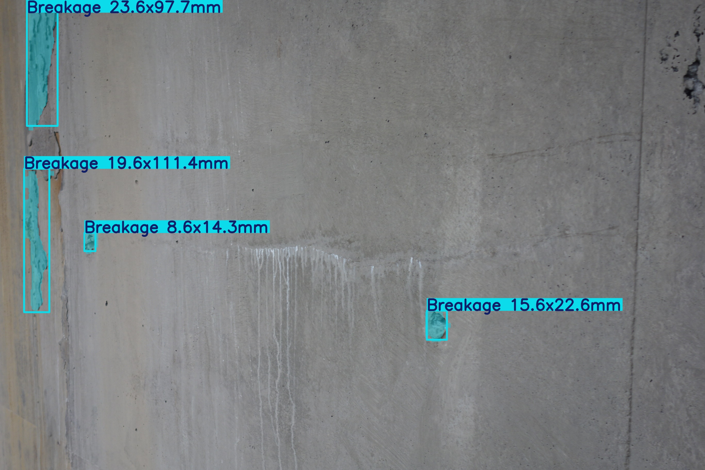
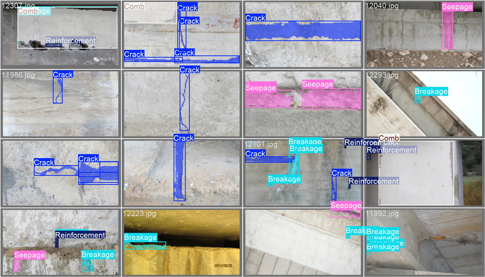
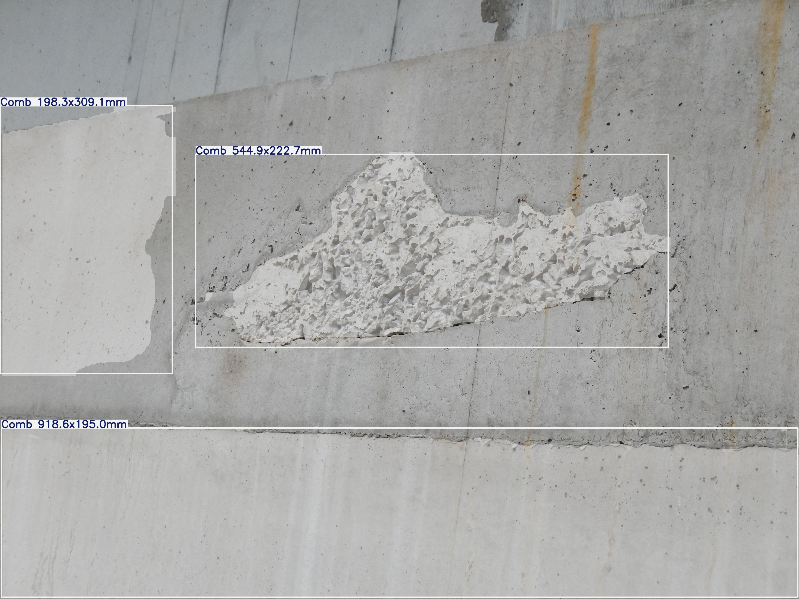
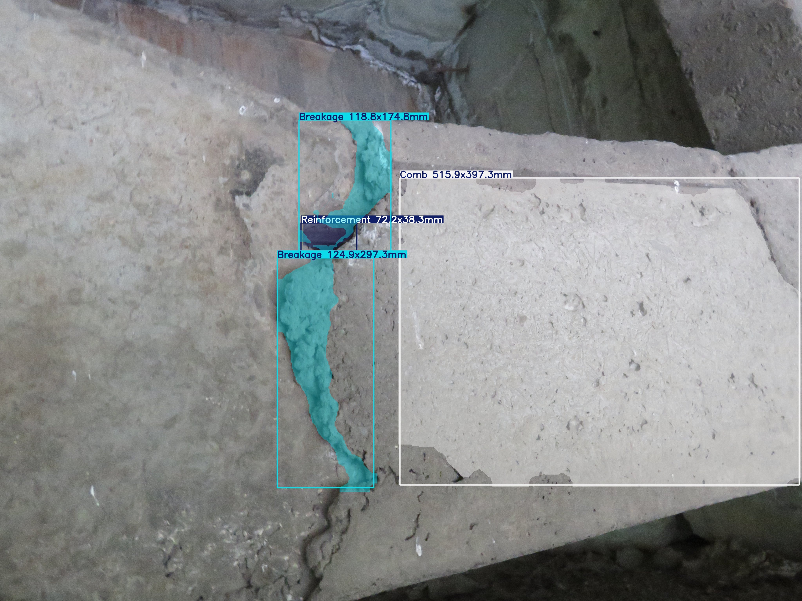
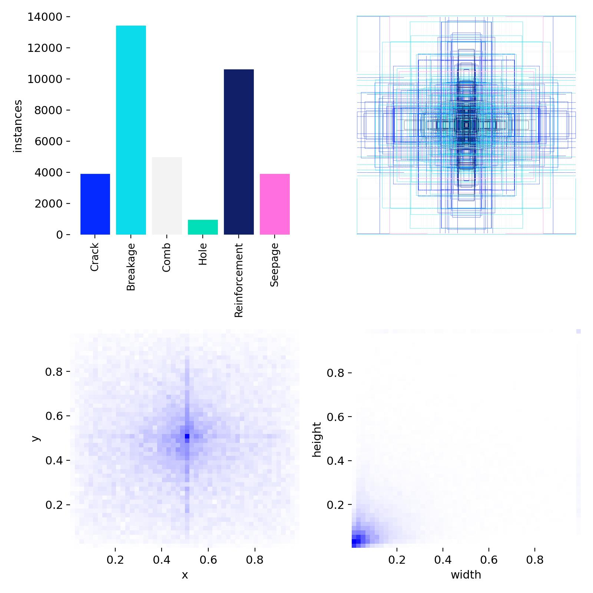
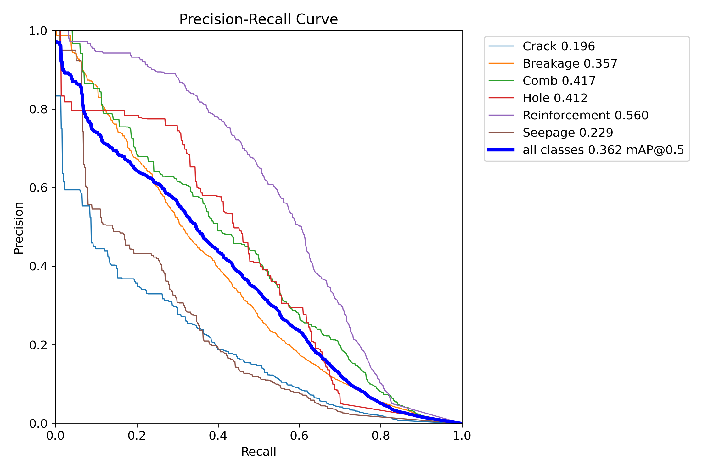
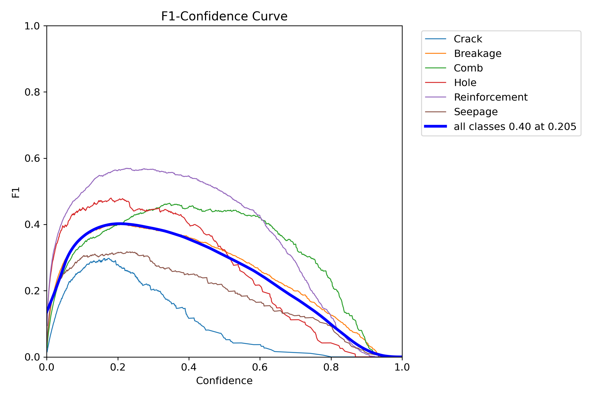
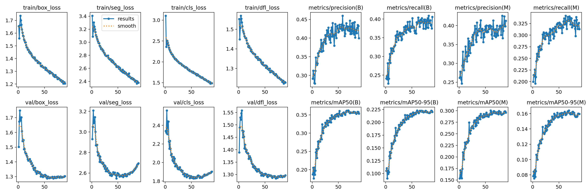
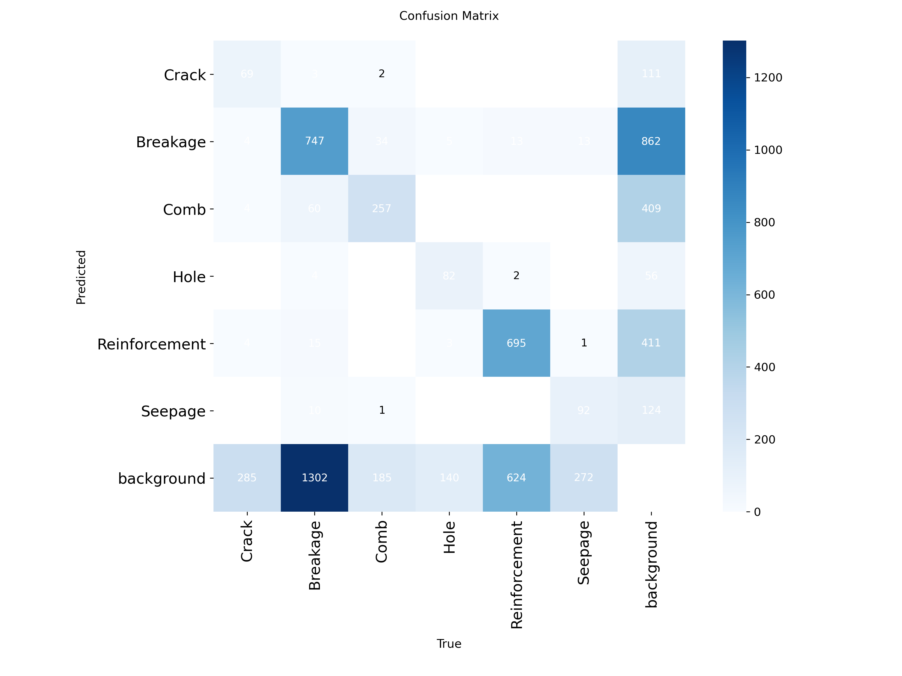
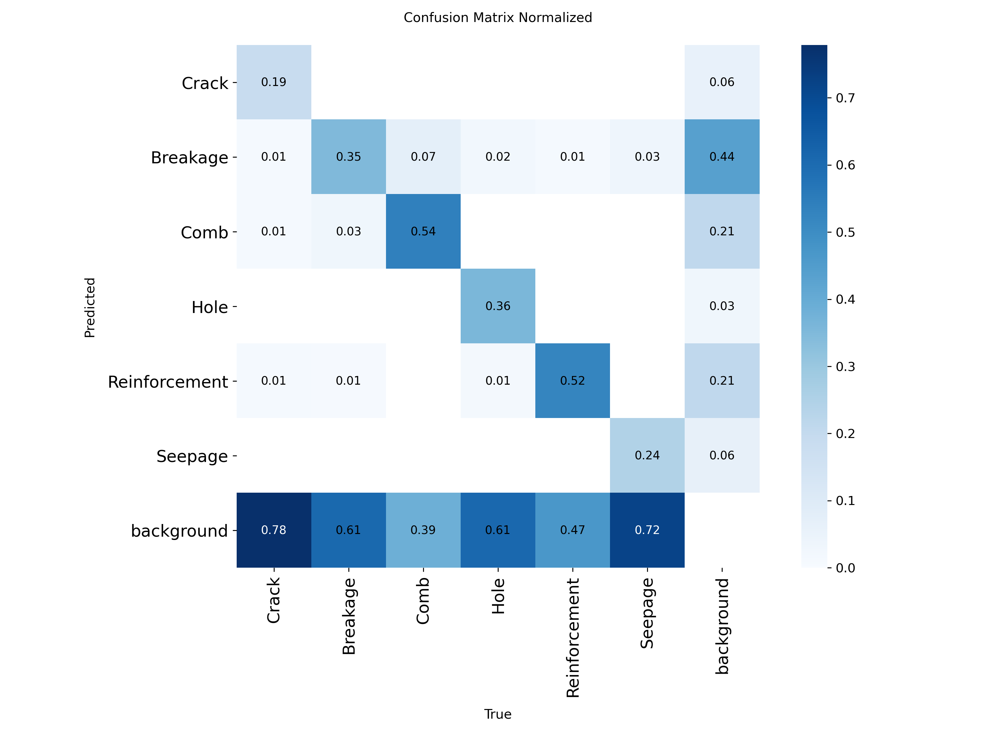

# Concrete Defect Detection — YOLO Segmentation for Infrastructure Inspection

YOLO instance segmentation for concrete structure defects — bridges, dams and building facades.
Detects and outlines six defect classes in inspection photos, with physical size (mm) annotated on the results.




## Problem

Concrete infrastructure needs regular defect inspection, but manual inspection is slow,
expensive and inconsistent — cracks and exposed rebar are easy to miss at scale.
This project trains a segmentation model that finds each defect, outlines its exact shape
(pixel mask, not just a box), and reports its physical size, so inspection output is
repeatable and measurable.

## Classes

| ID | Class | Meaning |
| --- | --- | --- |
| 0 | Crack | 裂缝 |
| 1 | Breakage | 破损 / 剥落 |
| 2 | Comb | 蜂窝麻面 |
| 3 | Hole | 孔洞 |
| 4 | Reinforcement | 钢筋外露 |
| 5 | Seepage | 渗水 |

## Demo




## Dataset

Custom concrete-inspection dataset (photos are private; code and result plots are public).

Train-set instance counts:

| Class | Instances |
| --- | --- |
| Breakage | ~13,400 |
| Reinforcement | ~10,600 |
| Comb | ~5,000 |
| Crack | ~3,900 |
| Seepage | ~3,900 |
| Hole | ~900 |



Notes: the dataset is **imbalanced** (Breakage has ~15× the instances of Hole) and most
instances are small relative to the image — both show up in the results below.

## Method

- Ultralytics YOLO instance segmentation (`yolo11s-seg.pt` starting point)
- Trained ~90 epochs on the custom dataset, standard augmentation
- Validation on held-out photos; plots below are the raw training outputs

## Results (validation)

| Metric | Value |
| --- | --- |
| mAP@0.5 (box) | **0.362** |
| mAP@0.5 (mask) | 0.30 |
| mAP@0.5-0.95 (box) | 0.22 |
| mAP@0.5-0.95 (mask) | 0.16 |
| Best F1 | 0.40 at confidence 0.205 |

Per-class AP@0.5:

| Class | AP@0.5 |
| --- | --- |
| Reinforcement | 0.560 |
| Comb | 0.417 |
| Hole | 0.412 |
| Breakage | 0.357 |
| Seepage | 0.229 |
| Crack | 0.196 |





## Failure Analysis

From the normalized confusion matrix (columns = ground truth):

- **Missed detections are the dominant error.** 78% of true Crack, 72% of Seepage and
  61% of Breakage/Hole instances are predicted as background — thin, small or
  low-contrast defects get skipped entirely.
- **Crack is the weakest class (AP 0.196).** Cracks are long and thin, so mask IoU is
  very sensitive to small shifts; the model also fires on surface stains that look similar.
- **Background false alarms.** Water stains, formwork seams and shadows trigger
  hundreds of false Breakage / Reinforcement predictions.
- **Breakage ↔ Comb confusion** — both are rough surface damage with similar texture.

Next steps: hard-example mining for Crack and Seepage, more data for the rare classes,
higher input resolution / tiled inference for small defects.




## Quick Start

```bash
pip install -r requirements.txt
python train.py --data data.yaml --model yolo11s-seg.pt --epochs 100
python predict.py --weights best.pt --source your_image.jpg
```

## Deliverables

- `best.pt` trained weights (kept outside the repo)
- `train.py` / `predict.py` (predict supports tiled inference for large photos)
- `data.yaml` dataset config for the 6 classes above
